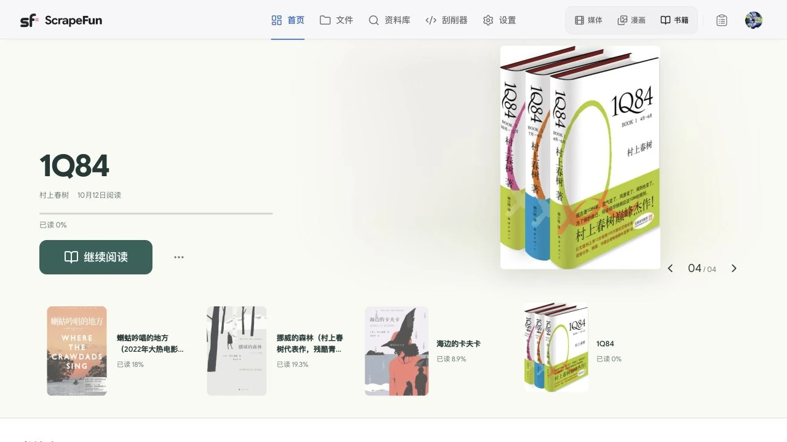
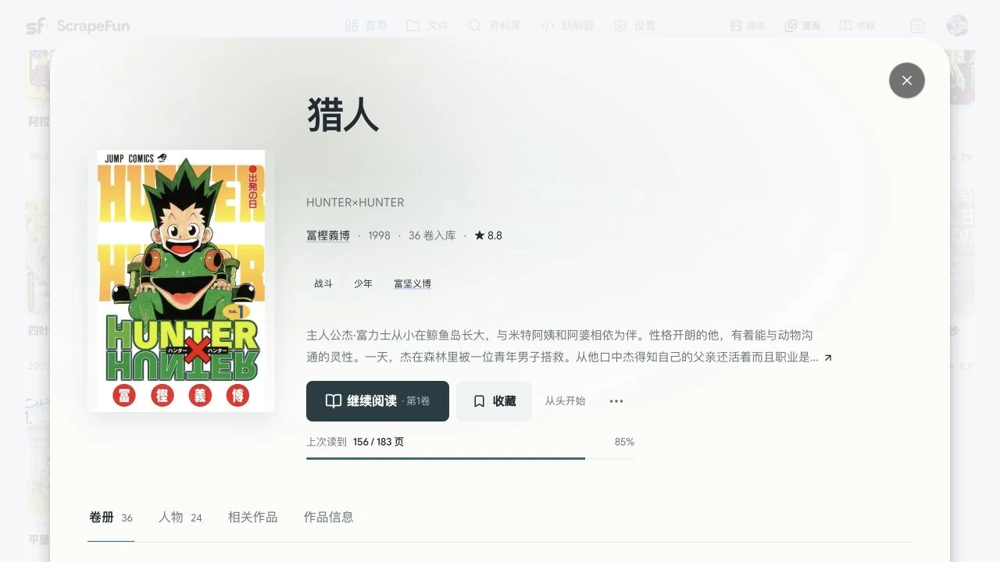

<div align="center">
  
  <h1>ScrapeFun</h1>
  <p><strong>简体中文</strong> · <a href="./README.en.md">English</a></p>
  <p>自托管媒体服务器 · 统一管理影视、漫画与远程媒体资源</p>
  <p>
    <a href="https://scrapefun.com/">产品网站</a> ·
    <a href="./docs/README.md">部署文档</a> ·
    <a href="#下载与部署">软件下载</a> ·
    <a href="./SUPPORT.md">支持与反馈</a>
  </p>
  
</div>

> 文档更新：2026-11-09。各平台独立发布，具体版本、系统要求及安装注意事项以对应 Release 为准。

ScrapeFun 将媒体刮削、资源浏览、播放、阅读和多用户管理集中在一个自托管服务中。你可以在 Linux / NAS、Mac 或 Windows 电脑上部署 Server，再通过浏览器或专用客户端连接。

本仓库提供公开产品文档、部署模板和扩展示例。完整产品源码不在此仓库中公开；平台仓库用于发布安装包和安装说明。

## 下载与部署

先部署一个 Server，再按需要安装 Client。Server 保存媒体库、用户、配置和进度；Client 连接已有 Server。使用浏览器可直接访问 Server，无需安装客户端。

| 类型 | 平台 | 公开安装方式 | 入口 |
| --- | --- | --- | --- |
| Server | Linux / NAS | Docker，仅支持 `linux/amd64` | [Docker 部署](./DOCKER_GUIDE.md) |
| Server | Linux | 原生 systemd / amd64 0.6.0 | [安装说明](./DOCKER_GUIDE.md#原生-systemd-安装) · [v0.6.0](https://github.com/HaoweiLi97/scrapefun-server-linux/releases/tag/v0.6.0) |
| Server | Android | arm64-v8a APK 0.5.10 | [安装说明](https://github.com/HaoweiLi97/scrapefun-server-android) · [稳定版](https://github.com/HaoweiLi97/scrapefun-server-android/releases/tag/v0.5.10) |
| Server | macOS | Apple Silicon / arm64 DMG 0.5.4 | [0.5.4 手动下载](https://github.com/HaoweiLi97/scrapefun-server-macos/releases/tag/v0.5.4) |
| Server | Windows | x64 EXE / Microsoft Store MSIX | [GitHub 下载](https://github.com/HaoweiLi97/scrapefun-server-windows/releases/tag/v0.6.0) · [Microsoft Store](https://apps.microsoft.com/detail/9N83B6RSWG01) |
| Client | Linux | x64 deb / AppImage 0.6.0 | [安装说明](https://github.com/HaoweiLi97/scrapefun-client-linux) · [v0.6.0](https://github.com/HaoweiLi97/scrapefun-client-linux/releases/tag/v0.6.0) |
| Client | macOS | Apple Silicon / arm64 DMG 0.5.4 | [0.5.4 手动下载](https://github.com/HaoweiLi97/scrapefun-client-macos/releases/tag/v0.5.4) |
| Client | Windows | x64 EXE / Microsoft Store APPX | [GitHub 下载](https://github.com/HaoweiLi97/scrapefun-client-windows/releases/tag/v0.6.0) · [Microsoft Store](https://apps.microsoft.com/detail/9NM3HPS675QH) |
| Client | Android | arm64-v8a / armeabi-v7a APK 0.6.0 | [安装说明](https://github.com/HaoweiLi97/scrapefun-client-android) · [稳定版](https://github.com/HaoweiLi97/scrapefun-client-android/releases/tag/v0.6.0) |

可用架构与包格式以实际 Release 资产和 Docker 标签的镜像清单为准。

Server 0.6.0 提供 Docker、Linux 原生版和 Windows EXE，Client 0.6.0 提供 Linux、Windows EXE 和 Android APK。0.6.0 新增自定义元数据、媒体库详情布局，并改善详情加载。Windows GitHub EXE 未签名，安装时可能显示 Microsoft Defender SmartScreen 提示。Microsoft Store 的版本以各商店页面为准。

## 快速开始

在 x86-64 Linux 主机安装 Docker、Docker Compose 插件和 `flock`（通常由 `util-linux` 提供）后，运行：

```bash
curl -fsSL https://raw.githubusercontent.com/HaoweiLi97/ScrapeFun/main/scripts/one-click-compose-deploy.sh | bash -s -- stable
```

脚本自动检测 GPU 并执行容器预检；可通过 `SCRAPEFUN_GPU_MODE` 显式指定模式。脚本默认使用 `~/scrapefun` 保存部署配置、`~/scrapefun-data` 保存业务数据，并启动 app 与独立 updater。

部署完成后，在浏览器中打开：

```text
http://服务器IP:8096
```

按页面引导完成初始化、设置管理员凭据并添加存储和媒体库。NAS 面板用户请阅读 [Compose 部署指南](./DOCKER_COMPOSE_DEPLOYMENT.md)。升级已有实例前请先完成[数据备份](./DOCKER_DATA_AND_BACKUP.md)。

## 产品能力

| 领域 | 提供的能力 |
| --- | --- |
| 媒体整理 | 电影与剧集刮削、海报和演员信息、清洗规则、自定义刮削器与组合刮削 |
| 漫画阅读 | 漫画扫描、网页与客户端阅读、阅读进度保存 |
| 远程资源 | WebDAV / AList 浏览与文件管理、远程媒体库扫描、资源连接 |
| 播放与字幕 | 网页与客户端播放、播放进度同步、字幕搜索与导入 |
| 用户管理 | 管理员与普通用户、媒体库访问权限、多设备访问 |
| 扩展能力 | Emby / Jellyfin 风格兼容接口、画面增强等 Pro 功能 |

部分高级功能需要有效的 ScrapeFun Pro 授权。具体权益与有效期以[产品权益说明](https://scrapefun.com/#/pro)、购买页面和实例内许可证页面为准；播放器兼容性同时受客户端版本、媒体编码及服务器配置影响。

## 界面预览

以下截图于 2026-11-03 从正在运行的 ScrapeFun 截取。不同平台、版本和个人设置可能影响显示效果。

<details>
  <summary>漫画库与阅读进度</summary>

查看漫画封面、卷册和阅读进度，继续上次阅读。


</details>

<details>
  <summary>书籍库</summary>

通过封面浏览书籍，集中查看阅读中的作品。



</details>

<details>
  <summary>远程资源浏览</summary>

浏览远程目录，以海报或列表查看媒体资源。


</details>

<details>
  <summary>作品详情</summary>

集中查看作品资料、简介、阅读进度与卷册入口。



</details>

## 文档导航

| 任务 | 文档 |
| --- | --- |
| API 接入与自动化 | [认证、媒体与任务](./docs/developers/api.md) · [OpenAPI](./docs/developers/openapi.json) |
| 设置与 AI 接入 | [常用设置](./docs/developers/settings.md) · [文本、语音与图像 AI](./docs/developers/ai-settings.md) |
| 编写与管理刮削器 | [方法与数据格式](./docs/developers/scrapers.md) · [测试和管理 API](./docs/developers/scraper-api.md) |
| Linux 安装、更新与频道切换 | [Docker 部署与运维](./DOCKER_GUIDE.md) |
| 在 NAS 面板手动配置 | [Docker Compose 部署](./DOCKER_COMPOSE_DEPLOYMENT.md) |
| 备份、迁移与故障恢复 | [数据持久化、备份与恢复](./DOCKER_DATA_AND_BACKUP.md) |
| 查看配置字段 | [环境变量示例](./.env.example) · [配置 Schema](./server-env.schema.json) |
| 编写刮削器 | [中文开发指南](./server/SCRAPER_GUIDE.zh-CN.md) · [English guide](./server/SCRAPER_GUIDE.md) |
| 核对版本与更新规则 | [发行与兼容性说明](./RELEASE_POLICY.md) |
| 报告问题或安全漏洞 | [支持与反馈](./SUPPORT.md) · [安全说明](./SECURITY.md) |
| 查询软件授权 | [许可与协议](./legal/README.md) |

完整使用文档见[在线文档中心](https://scrapefun.com/#/docs)。

## 数据与更新

Docker 必须持久化完整数据根目录：

```yaml
volumes:
  - ./scrapefun-data:/app/data
```

更新会重启 Server，并中断正在进行的播放和后台任务。先备份，再更新，最后检查登录、媒体库、图片、播放与阅读进度。`latest` 是稳定版频道别名，`beta` 是测试版频道别名；需要固定版本时使用明确的版本标签。

macOS Server [0.5.4](https://github.com/HaoweiLi97/scrapefun-server-macos/releases/tag/v0.5.4) 仅提供 Apple Silicon 版本，需要 macOS 27.0 或更新系统；macOS Client [0.5.4](https://github.com/HaoweiLi97/scrapefun-client-macos/releases/tag/v0.5.4) 面向 Apple Silicon，需要 macOS 26.0 或更新系统。两者均使用 ad-hoc 完整性签名，未经 Developer ID 签名和 Apple 公证；本版请手动下载安装，首次打开按对应 Release 说明解除隔离。

## 联系与授权

使用问题请通过 [GitHub Issues](https://github.com/HaoweiLi97/ScrapeFun/issues) 或[产品反馈页面](https://scrapefun.com/#/contact)提交。涉及账号、付费或私密日志，请发送至 `scrapefun@outlook.com`；商业合作可联系 `lihaowei977@gmail.com`。

软件、文档和第三方组件的授权范围见[许可与协议](./legal/README.md)。
